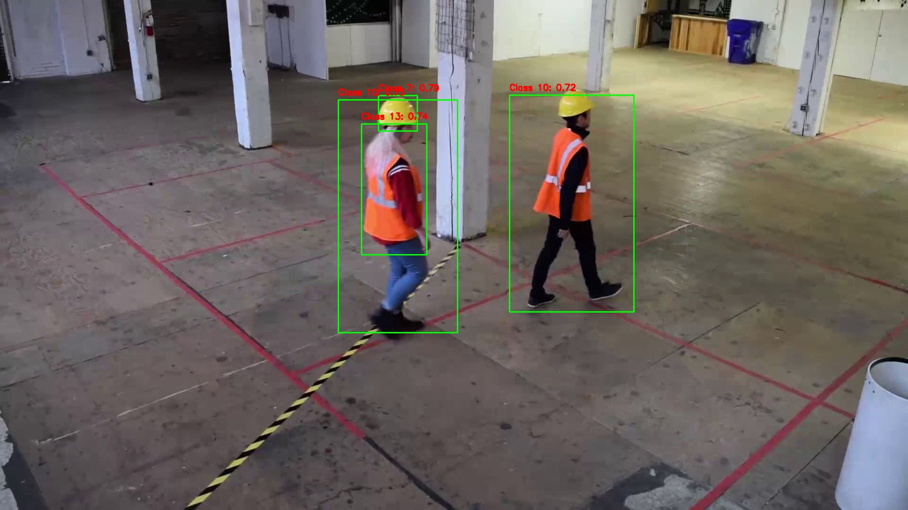
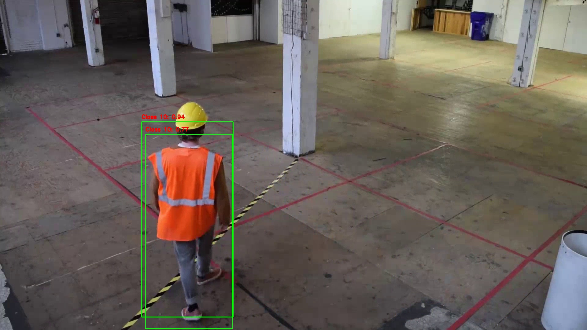

# TechTrack Object Detection Inference

A streaming object detection service for logistics scenes. It samples frames from a video stream, runs a YOLOv4-tiny detector through OpenCV's DNN module, filters overlapping boxes with a NumPy implementation of non-maximum suppression, and saves annotated frames. It also includes the evaluation and rectification tools used to compare detectors and choose retraining data.

The detector recognizes 20 classes, including forklifts, freight containers, cardboard boxes, wood pallets, safety vests, helmets, barcodes, QR codes, and license plates.

<p align="center">
  
  
</p>
<p align="center"><em>Annotated frames from the two YOLO models compared in the case study.</em></p>

## Results

Both YOLO models were evaluated on a random sample of 1,000 labeled frames (3,627 objects) with [scripts/evaluate_models.py](techtrack/scripts/evaluate_models.py), using standard per class average precision at IoU 0.5.

| Model | mAP@0.5 | Precision, recall, F1 at score 0.5 | Precision, recall, F1 at score 0.1 |
|---|---|---|---|
| YOLOv4-tiny model 1 | 0.568 | 0.847, 0.288, 0.430 | 0.652, 0.524, 0.581 |
| **YOLOv4-tiny model 2** | **0.596** | 0.860, 0.351, 0.498 | **0.681, 0.563, 0.617** |

Model 2 is the stronger detector, ahead on 13 of 20 classes, with the largest gains on barcodes, road signs, and people. Both models do well on forklifts, vans, and barcodes (AP of about 0.8) and struggle on wood pallets, ladders, fire, and road signs (AP of about 0.3 or less), which are the natural targets for hard negative mining and more training data. At the service's default score threshold of 0.5 both models miss most objects, and a threshold near 0.1 gives the best balance of precision and recall. The full per class results are in [evaluation_results_1000_images.json](techtrack/scripts/evaluation_results_1000_images.json).

A later review fixed a bug in non-maximum suppression. Boxes were passed to the IoU function as x, y, width, height when it expects corner coordinates, so overlapping duplicates were rarely removed. Fixing it raised mAP from 0.530 to 0.568 for model 1 and from 0.546 to 0.596 for model 2, and removed about 10 to 18 percent of detections that were duplicates.

## How it works

1. **Frame sampling.** `Preprocessing` reads a video stream and yields every Nth frame.
2. **Detection.** `Detector` runs the YOLO network and converts raw outputs to boxes, class IDs, and confidence scores.
3. **Non-maximum suppression.** `NMS` removes overlapping boxes class by class, converting each box to corner coordinates before computing IoU.
4. **Evaluation.** `scripts/evaluate_models.py` scores each model with standard per class mAP and a score threshold sweep. `loss.py` computes YOLO style localization, objectness, and classification losses.
5. **Hard negative mining.** `HardNegativeMiner` ranks images by loss so that the hardest examples, such as crowded scenes or frames with many missed objects, can be prioritized for retraining.

The [case study](techtrack/CaseStudy.md) compares the two YOLO models on annotated frames and lays out how to measure per class improvements, robustness to noise, flips, and brightness changes, and the effect of the hard negative mining weight. The measured results above complete its model comparison.

## Running it

YOLO weights, the annotated logistics images, and the test videos were provided by the course and are not included. Place them under `techtrack/storage/` as described in [techtrack/README.md](techtrack/README.md), then run the service locally or in Docker.

```bash
pip install -r techtrack/requirements.txt
cd techtrack
python app.py
```

## Built with

Python, OpenCV, NumPy, Docker

## Context

Built for EN.705.603 Creating AI-Enabled Systems at Johns Hopkins University (Summer 2025). Course data, model weights, starter code, and unit tests are not included.
