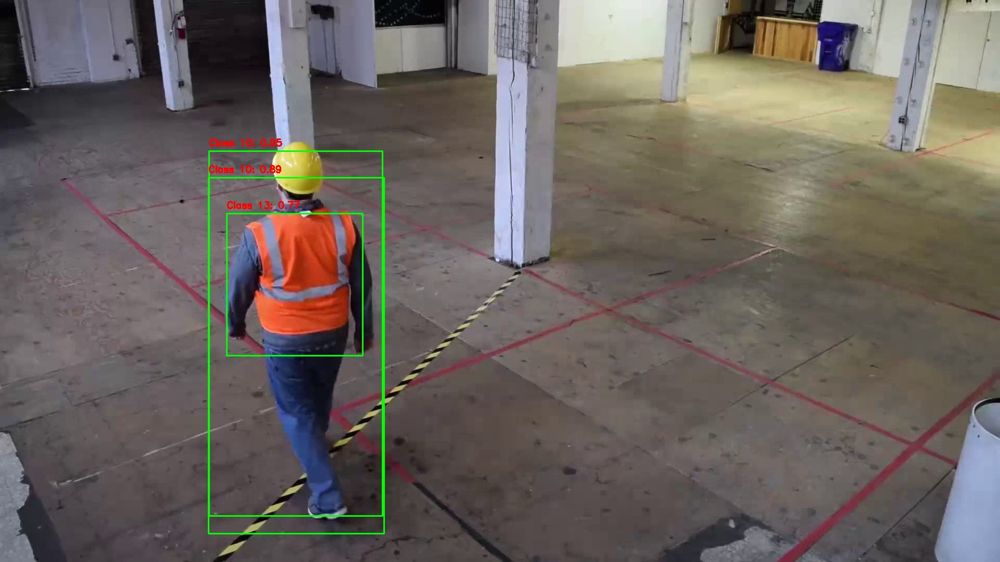
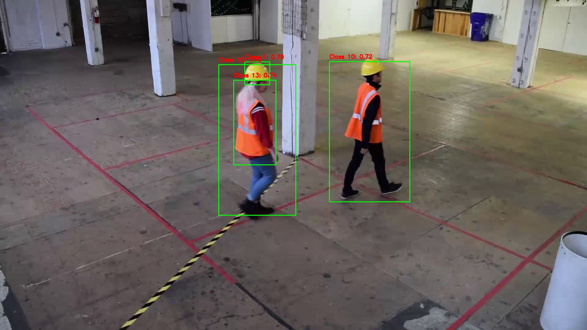
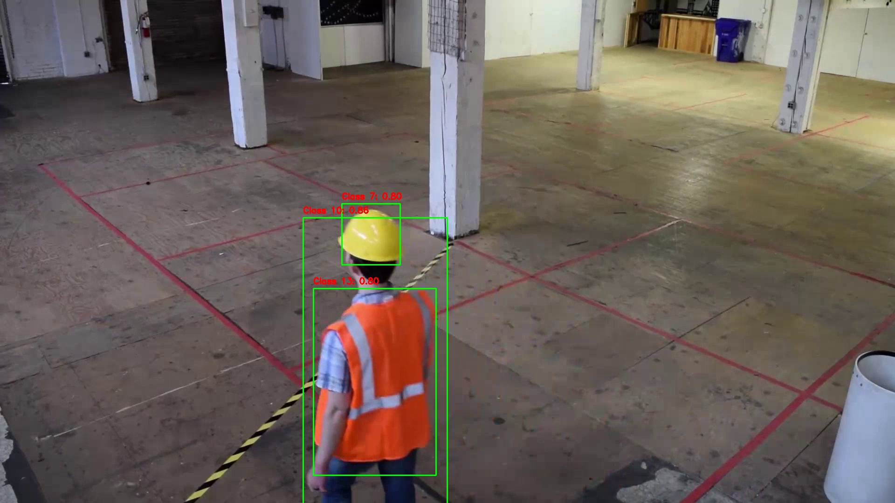
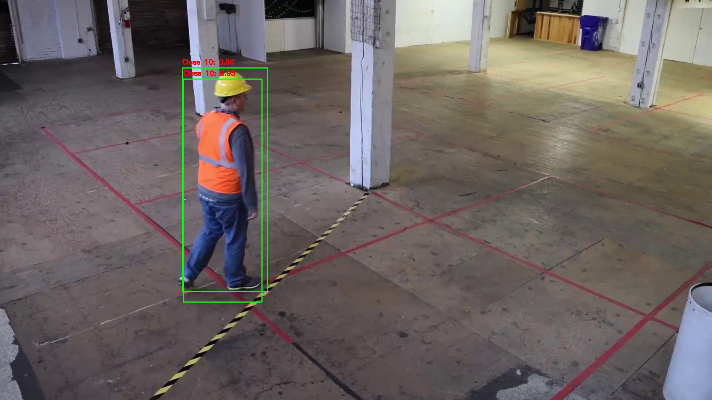
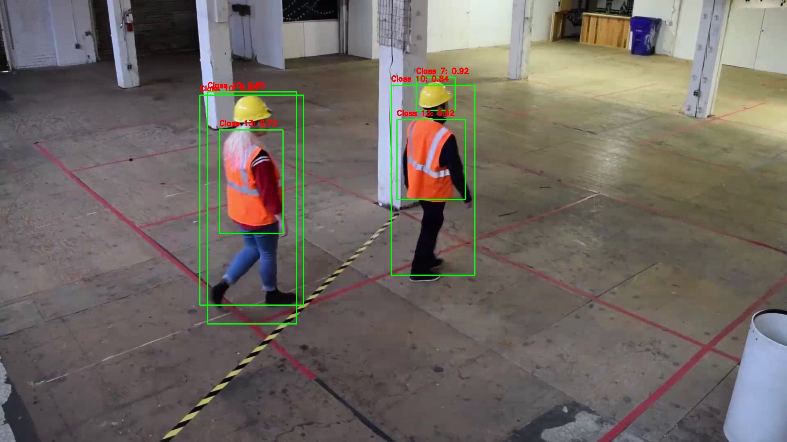
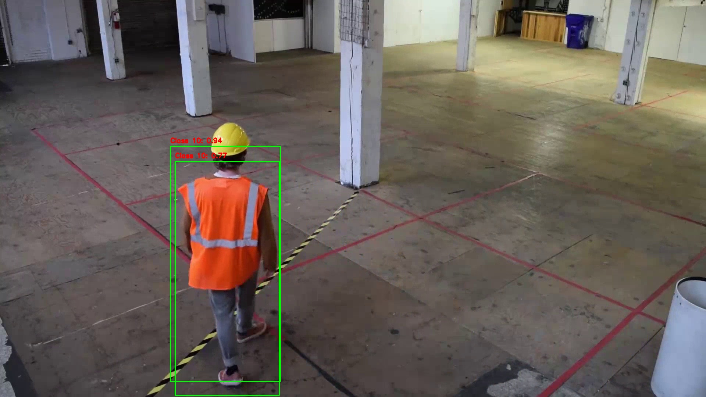

# TechTrack Object Detection and Inference System - Case Study

## Overview

This case study presents an evaluation plan and initial conceptual analysis for the TechTrack object detection system. It addresses five objectives: comparing two models, investigating class-specific improvements, measuring the effect of common augmentations, and analyzing the influence of Hard Negative Mining (HNM) parameters. Each section outlines the relevant metrics, explains why they matter, and provides placeholders for quantitative results.

Underlying these analyses are four core components - **Detector**, **Loss**, **NMS**, and **Augmenter**. All four of these enable consistent, robust, and interpretable results across the various experiments. Additionally, as we go through and extrapolate on the five tasks, it will be helpful to compare our findings to what would be considered the historical and to-be-expected results.

## **Provided Images**

Below are provided six total image detected frames, three from each model (YOLO Model 1 and YOLO Model 2, respectively). These will provide an ample comparison of how well each model was able to detect images within the .mp4 file video. In addition to the visual frames, the JSON files are also given, indicating the object detection box size, class ID that the detection corresponds to, and overall detection score.

Also shown here is `logstics.names`, the simple plain-text file listing the names of the object classes the detector is trained to recognize, with one class per line. For exapmle, when YOLO predicts that a detection belongs to `class_id = 10`, you map that to "person" by looking up logistics.names[10]. The detection score is the product of the objectness score and the highest class score, representing the final confidence that a detected box both contains an object and correctly identifies its class.

```
barcode
car
cardboard box
fire
forklift
freight container
gloves
helmet
ladder
license plate
person
qr code
road sign
safety vest
smoke
traffic cone
traffic light
truck
van
wood pallet
```



**Figure 1: Object Detection Frame of One Individual from YOLO Model 1**

```
{
  "frame": 3,
  "detections": [
    {
      "bbox": [
        401,
        290,
        333,
        701
      ],
      "class_id": 10,
      "score": 0.9476473927497864
    },
    {
      "bbox": [
        400,
        341,
        337,
        684
      ],
      "class_id": 10,
      "score": 0.8912357687950134
    },
    {
      "bbox": [
        435,
        410,
        261,
        273
      ],
      "class_id": 13,
      "score": 0.7748215198516846
    }
  ]
}
```



**Figure 2: Object Detection Frame of Two Individuals from YOLO Model 1**

```
{
  "frame": 28,
  "detections": [
    {
      "bbox": [
        800,
        202,
        82,
        75
      ],
      "class_id": 7,
      "score": 0.7877407073974609
    },
    {
      "bbox": [
        715,
        211,
        252,
        493
      ],
      "class_id": 10,
      "score": 0.7302777767181396
    },
    {
      "bbox": [
        1077,
        201,
        263,
        459
      ],
      "class_id": 10,
      "score": 0.7162486910820007
    },
    {
      "bbox": [
        764,
        262,
        138,
        277
      ],
      "class_id": 13,
      "score": 0.7447472214698792
    }
  ]
}
```



**Figure 3: Object Detection Frame of A Different Individual from YOLO Model 1**

```
{
  "frame": 29,
  "detections": [
    {
      "bbox": [
        560,
        298,
        258,
        616
      ],
      "class_id": 10,
      "score": 0.9680739641189575
    },
    {
      "bbox": [
        547,
        261,
        259,
        622
      ],
      "class_id": 10,
      "score": 0.8709954619407654
    },
    {
      "bbox": [
        549,
        398,
        226,
        305
      ],
      "class_id": 13,
      "score": 0.8512102365493774
    }
  ]
}
```



**Figure 4: Object Detection Frame of One Individual from YOLO Model 2**


```
{
  "frame": 3,
  "detections": [
    {
      "bbox": [
        494,
        213,
        212,
        602
      ],
      "class_id": 10,
      "score": 0.9515587687492371
    },
    {
      "bbox": [
        491,
        183,
        230,
        603
      ],
      "class_id": 10,
      "score": 0.8965368866920471
    }
  ]
}
```



**Figure 5: Object Detection Frame of Two Individuals from YOLO Model 2**

```
{
  "frame": 16,
  "detections": [
    {
      "bbox": [
        1015,
        189,
        95,
        80
      ],
      "class_id": 7,
      "score": 0.9225512146949768
    },
    {
      "bbox": [
        487,
        232,
        253,
        513
      ],
      "class_id": 10,
      "score": 0.8506215214729309
    },
    {
      "bbox": [
        506,
        224,
        217,
        567
      ],
      "class_id": 10,
      "score": 0.8488026261329651
    },
    {
      "bbox": [
        954,
        208,
        204,
        464
      ],
      "class_id": 10,
      "score": 0.8412219285964966
    },
    {
      "bbox": [
        968,
        292,
        167,
        195
      ],
      "class_id": 13,
      "score": 0.9224035143852234
    },
    {
      "bbox": [
        535,
        317,
        155,
        253
      ],
      "class_id": 13,
      "score": 0.7331430315971375
    }
  ]
}
```



**Figure 6: Object Detection Frame of A Individual from YOLO Model 2**

```
{
  "frame": 37,
  "detections": [
    {
      "bbox": [
        463,
        398,
        299,
        639
      ],
      "class_id": 10,
      "score": 0.9368736147880554
    },
    {
      "bbox": [
        476,
        439,
        283,
        636
      ],
      "class_id": 10,
      "score": 0.7737067341804504
    }
  ]
}
```

Currently, we can see that both YOLO Model 1 and YOLO Model 2 appear to detect the given objects correctly. Due to the location at which the video file is recorded, most of these observations appear to be orange/yellow vests, hardhats, and people. In all cases, the object detection score is high enough to reveal accurate probability and confidence in what we're observing, taking the amount of people and distance into account. Though our current directory is not functionable and versatile enough to display metrics, it's still worth going through the various tasks and exploring what a user is likely to expect upon deeper analysis.

## Task 1: Compare Model 1 and Model 2 on the TechTrack Dataset

When comparing two versions of the same YOLO-family detector, there are a few factors to keep in mind. First, the mAP (mean Average Precision) using an IoU (Intersection over Union) of around 0.5 for a YOLOv4-tiny model, on medium complexity datasets (such as COCO or easily accessible custom traffic sets), typically lands somewhere between 25% to 40%. Additionally, if the second model is a finetuned or retrained version of the existing first model, you often see a 2% – 5% mAP improvementm assuming the training was performed properly.

It should be noted that class-wise AP can vary widely, as large objects (such as cars and trucks) often have higher AP values (40 to 60%), while small or occluded classes (in this example, potentially pedestrians and traffic signs) can lag behind, with values in the range of 20% to 35%. However, one element that remains the same across models regardless of fixes or improvements is inference time - these usually remain similar unless explicitly changed.

**Recommended Metrics:**

Below are a list of metrics recommended to those who wish to perform high-quality experimentation and analysis regarding the topics at hand (object detection and inference).

* **Mean Average Precision (mAP):** The primary metric for object detection tasks, summarizing how well a model balances precision (avoiding false positives) and recall (capturing true positives) across multiple Intersection over Union (IoU) thresholds.
*  **Average Precision (AP):** Highlights how well each class is detected individually.
*  **Precision and Recall:** Basic yet essential for understanding trade-offs.
*  **Inference Time:** Useful for practical deployment considerations.

The `Detector` module serves as the backbone for this evaluation, transforming each input image into reliable candidate detections. The integrated `NMS` module filters overlapping predictions, ensuring clean, non-duplicative boxes for fair metric computation. Together, they enable accurate mAP and AP calculations. The `Loss` module is also used to quantify errors on each image, supporting additional diagnostic insights beyond standard metrics.

## Task 2: Identify Which Classes Model 2 Handles Better Than Model 1

Usually, classes with more training examples or larger objects benefit the most. If the second model was improved by adding more data or tweaking anchors, we'll likely see a 5% – 10% AP improvement for mid-sized vehicles. Additionally, there should be a modest or negligible change for easy classes (such as big trucks), and a possible worse performance on underrepresented rare classes, if overfitting occurred somewhere during the process. In short, model 2 should likel show clear improvement for the dominant classes.

Class-wise improvements are derived directly from the `Detector` outputs, post-processed with `NMS` for clean predictions per class. Comparing per-class AP illustrates where architectural or training changes in Model 2 yield better localization or classification, especially for challenging categories with overlapping instances.

## Task 3: Measure the Impact of Gaussian Noise, Vertical Flips, and Brightness Adjustments

There are various well-known effects of the three aforementioned effects To start, Gaussian Noise can result in a 2% to 10% mAP drop, depending on noise severity. Tiny YOLO models are not very robust to heavy noise without explicit training for it, hence the reduction in mAP. Even more drastically, Vertical Flipping can result in a massive 20% to 50% mAP drop if the detector was never trained with flipped data. When objects appear in uncommon orientations (like upside-down), the learned shape and pose priors from the training set are violated in a way that the model can't work around. By comaparison, a change in the brightness results in only a mild drop, about 1% to 5% for moderate darkening or brightening. This numerical value is subject to change, depending on the amount of overexposure to whiteout or similar process. These various effects are why real-world deployable models often use heavy data augmentation during training.

These robustness tests rely on the `Augmenter` module to systematically apply noise, flips, and brightness changes to input images during evaluation. The `Detector` then predicts on these altered samples, and `NMS` ensures the results remain interpretable. Comparing metrics pre- and post-augmentation reveals how resilient each model is to real-world variation.

## Task 4: Analyze How Different $\lambda$ Values in Hard Negative Mining Affect Sampling of Images with Many Ground-Truth Objects

Recall that in our system, $\lambda$ is a hyperparameter that controls how aggressively the training or sampling process focuses on hard examples — that is, examples where the model performs poorly (like crowded scenes or frames with missed detections). In practical terms, a low $\lambda$ means that we select mostly typical samples, with little extra emphasis on mistakes, while a high $\lambda$ has us bias our sampling towards the hardest examples (the ones with the highest loss). By doing so, the model has more chances to learn from its biggest errors.

The general trend is that increasing $\lambda$ focuses on the more dense scenes - city intersections, crowded parking lots, groups of people, and so on. Thus, the average ground truth objects per mined sample rises with $\lambda$. This is expected because the loss is naturally higher when the model must predict many overlapping boxes.

The `Loss` module computes detailed per-sample loss values, which inform the `HardNegativeMiner` on how challenging each image is. By adjusting $\lambda$, we vary how many high-loss samples (often scenes with many overlapping true objects) are emphasized during training or evaluation. The `Detector` consistently supplies predictions, and `NMS` ensures that overlapping detections don’t inflate loss terms. By combining accurate `Loss` signals with consistent `Detector` outputs and robust `NMS` filtering, our pipeline highlights where the model struggles with crowded scenes. This informs model refinement strategies to better handle real-world clutter.

## Task 5: Analyze How Different $\lambda$ Values in Hard Negative Mining Affect Sampling of Images with Many False Negatives

As we alluded to in the above section, the expected trend is that a higher $\lambda$ will lead to more images with tricky occlusions or small objects. As such, the average false negative per image should climbs, with the exact numbers depending on how undertrained the model is — less mature detectors show steeper differences.

Similar to Task 4, the `Loss` module flags images where predictions fail to match existing objects — a direct measure of false negatives. Higher $\lambda$ values amplify the likelihood of selecting such images during training or error analysis. The `Detector` and `NMS` guarantee that these failure cases are consistent and meaningful for iterative improvements. This analysis uses the same consistent `Detector`, `Loss`, and `NMS` stack to surface blind spots in detection performance. By systematically mining these difficult cases, we guide future training to reduce miss rates and improve recall.

## Conclusion

This document outlines the conceptual framework for evaluating the TechTrack object detection system. Each module — **Detector**, **Loss**, **NMS**, and **Augmenter** — plays a critical role in generating robust, comparable, and actionable results. Standard object detection metrics, informed augmentations, and principled sampling strategies collectively ensure a comprehensive performance assessment. Quantitative results will be incorporated at a later time upon completing experiments, supporting each insight with clear, reproducible evidence.